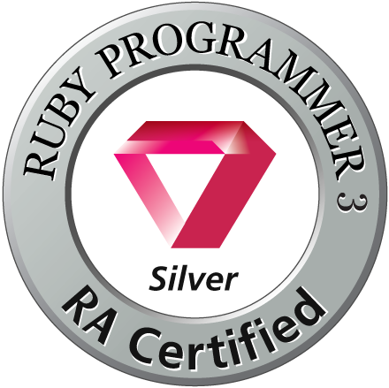

---

# Eli（えり）🐹

現在は、医療関係の学術集会向けWebシステムの運用・保守に携わり、Perl・HTML・CSSを用いた登録画面の修正や、問い合わせ対応などを行っています。

基本情報技術者試験の学習をきっかけにオブジェクト指向に興味を持ち、Rubyを学び始めました。
フィヨルドブートキャンプでRuby on Railsを中心にWebアプリケーション開発を学び、現在も個人開発や技術学習に取り組んでいます。

### About me

- 新しいことを学び、できることを増やすのが好きです。
- 学んでいる人たちと協力することが好きです。より良いチームを作るにはどうすればよいか、考えていきたいです。
- 日々の不便さや課題を、仕組みの改善によって解決することに関心があります。
- 趣味は 読書、アニメ・漫画、散歩、筋トレ など。英語、心理学、哲学も興味があります。
- ハムスターとピカチュウが好きです🐹

### 作ったもの

- [ReNovo](https://github.com/koguchi-e/ReNovo)
- [TimeCalc](https://github.com/koguchi-e/timecalc)
- [Taskun](https://github.com/koguchi-e/Taskun)

### 資格

- Ruby Silver
- 基本情報技術者試験
- ITパスポート
- 秘書検定2級
- 3級ファイナンシャル・プランニング技能士

### Links

- [プロフィールページ](https://koguchi-e.github.io/profile-page/)
- [Zenn](https://zenn.dev/eliri)
- [はてなブログ](https://eliri.hatenablog.com/)
- [X](https://x.com/___eliri)
